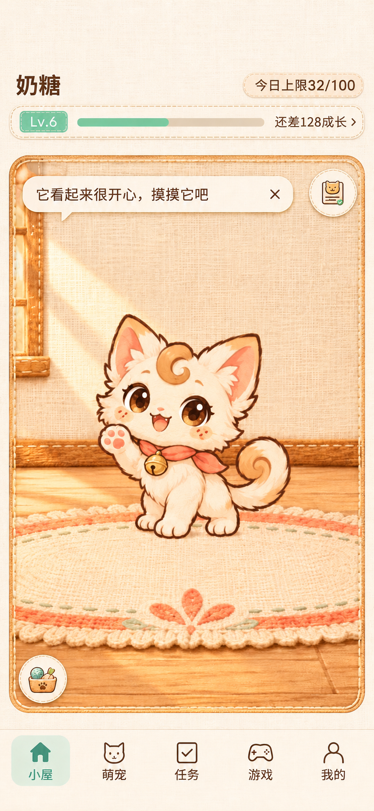
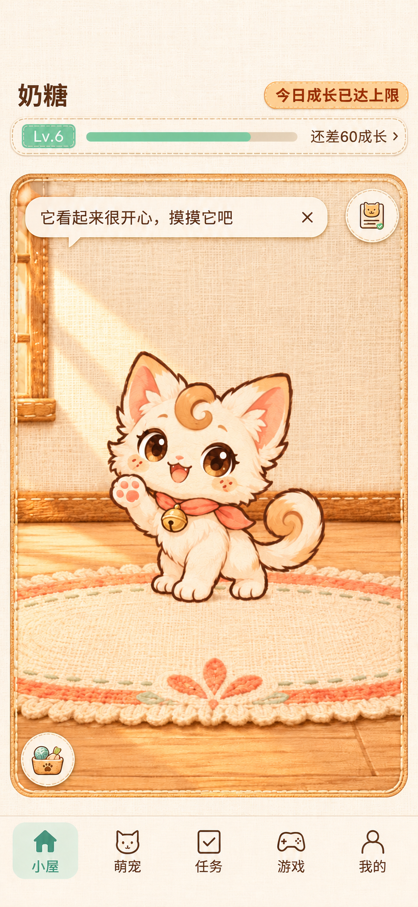

# 首页宠物信息区设计定稿

| 项目 | 内容 |
| --- | --- |
| 确认日期 | 2026-11-08 |
| 版本 | v1.2 |
| 状态 | 已实现，通过自动化测试与模拟器回归；待真机验收 |
| 设计对象 | 小屋首页顶部的宠物身份、等级成长和每日成长额度 |
| 选定方案 | 最新一轮第三版，缝线成长签 |
| 参考版本 | 2026-11-08 获取的当前项目模拟器首页，五栏导航为小屋、萌宠、任务、游戏、我的 |

## 1. 目标与设计结论

原首页将宠物名、等级、距下一级成长、今日成长依次排为四行，信息层级较弱，当前等级与下一等级的表述也占用了额外空间。定稿将身份和每日额度放到第一行，将等级与升级进度组合到第二行，以两组信息呈现。

沿用当前项目的象牙白亚麻背景、暖棕文字、薄荷绿成长进度、细缝线和布艺质感。顶部使用完整可用宽度，配合当前首页结构安排空间。

| 已确认项目 | 最终要求 |
| --- | --- |
| 整体结构 | 采用第三版布局，宠物名在第一行左侧，每日上限标签在右侧；下方为横向缝线成长签 |
| 成长签 | 从左到右依次为等级布签、成长进度条、剩余成长文字和详情箭头 |
| 普通文案 | 示例为“今日上限32/100”，数字随当前宠物当天实际获得的成长更新 |
| 满额文案 | “今日成长已达上限” |
| 普通标签 | 浅色布艺底、暖棕文字、细缝线描边 |
| 满额标签 | 暖杏色底、深橙色加粗文字，轮廓与底色增强辨识度 |
| 信息精简 | 宠物名、等级、升级剩余值、每日额度分别出现一次 |

## 2. 完整首页设计图

**以下两张独立图片分别呈现未达上限和已达上限时的完整首页，每张图均已融入最终确认的每日上限标签。** 两图包含完整顶部、宠物场景、抽屉入口及五栏导航，可直接作为对应状态的整体视觉依据。

### 图 01 · 完整首页，未达上限

右上角显示浅色布艺标签“今日上限32/100”；等级为 Lv.6，升级进度约 46.7%，右侧显示“还差128成长”。

### 图 02 · 完整首页，已达上限

右上角显示暖杏色布艺标签“今日成长已达上限”，配深橙色加粗文字；等级为 Lv.6，升级进度为 75%，右侧显示“还差60成长”。

两张完整图片尺寸均为 852×1846。图中的宠物、场景和图标包含图片生成偏差，后续实现应引用项目实际资源。首页外围区域以当前项目实现为依据。

## 3. 信息与显示规则

| 信息 | 显示规则 | 示例 |
| --- | --- | --- |
| 宠物名 | 第一行左侧，顶部主视觉文字 | 奶糖 |
| 每日成长未满 | 第一行右侧，文案为“今日上限{今日已获成长}/{每日上限}” | 今日上限32/100 |
| 每日成长已满 | 今日已获成长达到每日上限时，用满额文案替换整个数字文案 | 今日成长已达上限 |
| 等级 | 成长签左侧布签，显示当前等级 | Lv.6 |
| 升级进度 | 成长签中段，读取当前等级内已积累成长与该等级所需成长 | 112/240 对应约 46.7% 填充 |
| 剩余成长 | 成长签右侧，文案为“还差{剩余值}成长”，后接详情箭头 | 还差128成长 › |

业务沿用 `getDailyGrowth(pet, now)`、`MAX_DAILY_GROWTH` 和现有升级规则。当前每日上限为 100，当前等级所需成长为 `pet.level × 40`，当前级内成长为 `pet.xp`。实现时从业务数据读取每日上限。

升级进度与每日额度分别计算。定稿以进度条表达升级进度，以一处标签表达每日额度。满额标签显示完整句子，替换原数字文本；等级只在成长签左端出现；进度条旁仅保留剩余成长值。

两种示例状态对应同一只 Lv.6 宠物继续获得 68 点成长的过程。

| 状态 | 当日成长 | 当前级内成长 | 升级所需 | 距升级剩余 | 进度条 |
| --- | --- | --- | --- | --- | --- |
| 未达上限 | 32 | 112 | 240 | 128 | 约 46.7% |
| 已达上限 | 100 | 180 | 240 | 60 | 75% |

表中比例和当前级内数值用于说明计算关系，页面按原稿仅呈现进度填充与剩余成长。每日达到上限后，等级进度继续反映该等级内的真实积累，照料效果沿用现有业务规则。

## 4. 视觉与布局交接

已确认的视觉要求为两行布局、布艺成长签和每日上限双状态。以下尺寸与色值为后续实现的起始建议，最终需结合项目字体与模拟器画面校准。

| 要素 | 实现建议 |
| --- | --- |
| 顶部空间 | 以现有 72 逻辑像素顶部区域为基准，左右内边距约 16；顶部起点服从安全区及微信胶囊留白 |
| 第一行 | 名字左对齐，每日标签右对齐，垂直居中；为满额长文案预留宽度 |
| 名字 | 沿用约 17–18 逻辑像素的暖棕加粗字，保持身份信息层级 |
| 每日标签 | 建议约 12–13 逻辑像素，横向内边距约 10，圆角与细缝线；两个状态保持相同高度及右侧锚点 |
| 普通标签 | 象牙白或浅桃布艺底，深棕文字 |
| 满额标签 | 暖杏色底可从 `#F8DEB7` 起步，深橙加粗文字可从 `#8A421F` 起步，配柔和橙棕描边 |
| 成长签 | 浅色横向布面，细缝线描边；等级布签、进度条、剩余文字作为一个整体排布 |
| 成长进度 | 沿用薄荷绿体系，与暖杏色每日满额标签形成区分 |
| 窄屏 | 剩余文字与等级按实际文字宽度留位，中段进度条伸缩；标签完整可读，长名字按项目既有方式截断 |

每日满额通过文字、加粗和底色共同表达。每日标签承担状态展示；成长签右侧箭头承接现有成长说明入口，后续实现需为入口提供至少 44 逻辑像素的有效点击高度，并沿用引导期间的入口可见性规则。

## 5. 实现与验收要点

下表是本次实现的验收要求，实际执行范围与结果见第 7 节。

| 场景 | 验收要求 |
| --- | --- |
| 普通状态 | 显示“今日上限32/100”等真实数值；等级、名字与剩余成长各出现一次 |
| 达到上限 | 今日成长从 99 达到 100 时，替换为“今日成长已达上限”并应用高亮标签 |
| 跨日与切宠 | 标签与所选宠物、业务日期同步；新一天按真实当日值恢复普通状态 |
| 升级 | 等级、进度填充、剩余成长与升级后的业务结果一致 |
| Lv.99 满级 | 采用现有“已满级”语义替换升级剩余提示，满级时进度条填满；每日标签仍依照实际当日数据判断 |
| 长名字与满额文案 | 两组内容可辨识，互不覆盖，完整呈现满额句子 |
| 说明入口 | 点击成长签进入既有成长说明，关闭后返回首页；命中区域与引导规则一致 |
| 320×568 与高屏 | 检查两行顶部、微信胶囊安全区、场景、抽屉入口及五栏导航的排布和点击区域 |
| 状态反馈 | 每日满额与照料结果的说明一致，升级进度保持真实比例 |

相关代码入口为 `js/scene.js` 的 `compactHeader()`、`js/home-layout.js`、`js/growth-info.js`，业务数据来自 `js/model.js`。现已接入两行布局，成长签保留 44 窗口像素的点击高度。每日标签与升级进度分别计算，名字按剩余空间截断。

实现阶段先运行相关自动化测试，再在当前工作区对应的微信开发者工具模拟器检查上述路径，按项目规范记录结果和真机未覆盖风险。

## 6. 来源与归档记录

| 文件 | 来源与用途 |
| --- | --- |
| `图稿/01-完整首页-未达上限.png` | 内置 Image Gen 输出 `exec-a331d4ec-4ce2-415f-94f8-a9f9849baf69.png`，已融入普通每日上限标签的完整首页 |
| `图稿/02-完整首页-已达上限.png` | 内置 Image Gen 输出 `exec-2fc66092-4195-401f-973c-869a9234e1f7.png`，已融入高亮满额标签的完整首页 |

生成时以第三版完整页面作为编辑目标，以已确认的局部双状态稿作为标签样式参考，分别生成两张独立的完整首页。提示词核心约束为保持完整竖屏构图、象牙白布纹、薄荷等级签与升级条、第一行名字和每日额度、精确中文文案、每类信息出现一次，并保留宠物场景、抽屉入口和五栏导航。普通态采用浅色标签，满额态采用暖杏底深橙加粗标签；样例分别使用 Lv.6、今日成长 32 与 100、升级剩余 128 与 60。

两张完整首页 PNG 按原始输出复制归档。已逐张检查完整页面、每日标签文字、高亮样式和五栏导航，并核对图片文件完整性、源文件一致性及文档相对链接。设计阶段查看过 2026-11-08 的首页模拟器画面；实现后的自动化与模拟器验证见第 7 节。

早期材料保存在历史参考目录，供追溯设计过程。

- [第三版整体布局原稿](./图稿/历史参考/01-第三版整体布局原稿.png)
- [每日上限局部双状态参考](./图稿/历史参考/02-每日上限局部双状态参考.png)

v1.1 根据用户要求，将已确认的新标签分别融入两张完整首页图片，并更新本节的主图及引用。

本定稿是 2026-11-08 的首页顶部局部设计依据，阅读早期 `ui-design-v2` 材料时，应结合本次已确认的顶部结构与文案。

## 7. 实现与验证记录（2026-11-08）

v1.2 完成两行缝线成长签、薄荷等级与进度条、每日标签双状态。沿用项目 Canvas 绘制与布纹资源，不新增运行依赖，不更改成长业务规则。

- `js/scene.js`：名字和每日额度同排；下方组合等级、进度和剩余成长；满额采用暖杏底、深橙加粗文字及缝线描边。
- `js/home-layout.js`：顶部使用安全区内完整宽度，保留现有场景起点与 44 像素成长说明点击区域。
- `js/growth-info.js`：统一动态文案、满额判断、等级进度比例与 Lv.99 满级表达。
- `tests/home-header.test.mjs`：覆盖 99→100、跨日、切宠、旧存档缺失每日数据、满级、长名字及三个屏幕尺寸；布局检查调用实际 `resize()`。

| 验证方式 | 实际结果 |
| --- | --- |
| `npm test` | 161/161 通过 |
| 补强缩放后 `node --test tests/home-header.test.mjs` | 3/3 通过；最终全套结果同上 |
| `node --check`（三个修改的 JS 文件）及 `git diff --check` | 通过 |
| 独立代码审查 | 未发现问题；审查员复跑相关测试及缩放补强后的测试通过 |
| 微信开发者工具 2.02.2609250 Stable，基础库 3.17.4 | 确认项目路径为当前工作区，重新编译后检查 |
| 390×844 / 320×568，75% 显示比例 | 普通与满额标签完整，等级与剩余值不重复，进度比例正确，顶部、安全区、场景及五栏导航无遮挡 |
| 成长说明 | 两种尺寸均实际点击成长签打开说明，并点击“知道啦”关闭 |
| 导航路径 | 高屏实际进入“我的”，通过“回小屋”返回；进入“萌宠”，通过底栏返回小屋，顶部状态正常 |
| 满额照料 | 短屏展开照料抽屉并执行清洁；切换到洗浴场景、宠物图片加载完成，反馈今日成长已满；等级进度未增加 |

模拟器截图（实际运行画面，区别于第 2 节设计原稿）：

| 尺寸 | 普通状态 | 满额状态 |
| --- | --- | --- |
| 390×844 | [实际截图](./验证截图/普通-390x844.png) | [实际截图](./验证截图/满额-390x844.png) |
| 320×568 | [实际截图](./验证截图/普通-320x568.png) | [实际截图](./验证截图/满额-320x568.png) |

测试只操作已确认的模拟器，使用临时成长数据；结束时切回原 390×844 机型，模拟器保留 Lv.6 满额测试场景及自定义短屏预设。未修改真机存档。长名字、跨日、切宠和满级边界由自动化测试覆盖，未逐项做真机操作。未配置可运行的 lint 脚本，本次执行语法检查并核对最终差异。真机字体、性能与不同系统渲染仍需后续验收；本记录不代表真机验收。
