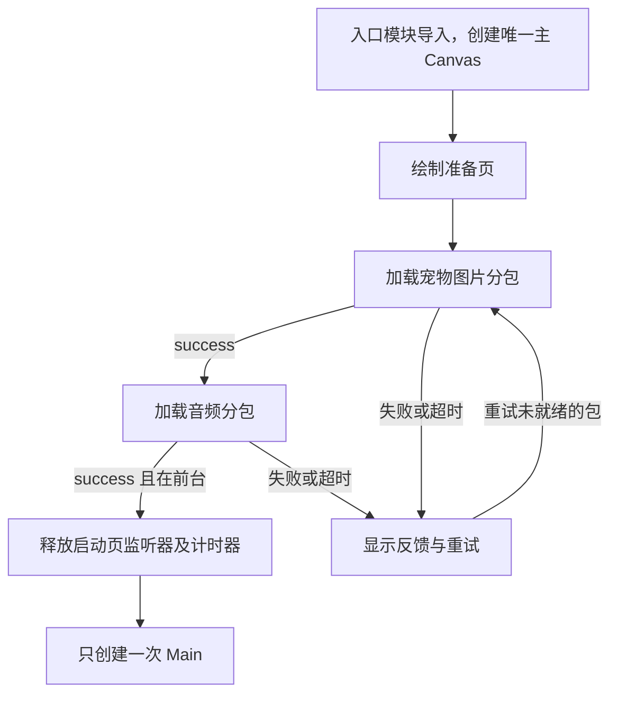

# 微信小游戏资源分包开发方案

日期：2026-11-16。状态：方案已批准，已在 `main-v1` 实现运行代码与自动化；实际模拟器和上传验证状态见[实现与验证记录](实现与验证记录.md)。下文保留设计与验收标准，文件清单中的“拟”表示方案原定范围。

## 1. 目标与实现范围

解决上传错误 `source size 6927KB exceed max limit 4MB`。采用两个普通资源分包：宠物状态图分包 `petSprites`、音频分包 `gameAudio`；两个分包成功加载后再创建游戏实例。

首版目标是可靠通过主包限制，保持现有画面和播放行为。素材目录、图片内容、音频编码、养育规则与存档格式沿用当前实现。后续按宠物或页面懒加载、CDN、视频资源接入不包含在本次任务内。首次进入仍需准备全部图片与音频，不能据此承诺总下载量减少或启动时间缩短。

验收条件：

| 编号 | 条件与预期结果 |
| --- | --- |
| AC01 | 编译打包时，24 张宠物状态图归属 `petSprites`，三首 BGM 和 23 个短音效归属 `gameAudio`；开发者工具实际主包小于 4M，内部目标不超过 3.5 MiB。 |
| AC02 | 启动时，用户立即看到主包绘制的准备页；两个分包均成功前，不创建 `Main`、不触发游戏存档读写与玩法输入、不播放声音。 |
| AC03 | 两包就绪且应用在前台时，启动页完成资源释放，游戏实例只创建一次；进入现有初次领养或已存档小屋路径。 |
| AC04 | 分包失败、抛异常或前台等待超时后，展示明确反馈及“重试”；重试保留本次进程内已成功的分包，忽略旧请求的迟到回调。 |
| AC05 | 准备期间切到后台，不重绘或误入游戏；回到前台按最新状态继续。准备页监听器和计时器不会在游戏开始后继续工作。 |
| AC06 | 游戏开始后，三宠物全部八种状态、照料场景、音乐、短音效、音乐开关及主要导航保持原有行为；异步图片仍按现有逻辑加载与重绘。 |
| AC07 | 缺少分包 API 时显示微信版本提示；分包失败不会走“资源已就绪”的直通路径，不覆盖或清除用户存档。 |

## 2. 现状与预算

现状证据：

- `game.js` 静态导入 `Main` 后立即 `new Main()`；`game.json` 目前只有竖屏配置。
- `js/main.js` 静态导入 `js/render.js`；后者创建主 Canvas 和 `GameGlobal.viewport`。创建 `Main` 才开始读取存档、注册玩法监听器、预载场景和运行循环。
- `js/scene.js` 按 `assets/pets/sprites/pet_${key}.png` 拼接宠物路径；`js/game-audio.js` 按 `audio/sfx/${id}.wav` 和 `audio/bgm/bgm_${name}.mp3` 拼接音频路径。
- `project.config.json` 已开启代码压缩，并忽略文档、测试、脚本、临时目录和美术探索稿。现有 `include` 为空。
- `project.private.config.json` 的 `bigPackageSizeSupport` 只放宽预览和真机调试体积；开发阶段无依赖文件过滤也不能替代上传阶段检查。

2026-11-16 复核的原始文件体积，1 MiB = 1,048,576 字节：

| 归属 | 内容 | 原始字节 | MiB |
| --- | --- | ---: | ---: |
| `petSprites` | `assets/pets/sprites/` 的 24 张 PNG | 2,917,626 | 2.782 |
| `gameAudio` | `audio/bgm/`、`audio/sfx/` | 1,207,099 | 1.151 |
| 主包 | UI、场景、现有 JS、入口、主题头像 | 3,035,168 | 2.895 |
| 合计 | 当前运行代码与上述资源 | 7,159,893 | 6.828 |

主包估算保留新主题头像和五张旧场景回退图，没有依赖删除资源。新增启动代码、两个分包入口、配置及工具元数据尚未计入，最终以开发者工具实际分包统计为准。按 3.5 MiB 内部目标，新增代码前有约 0.61 MiB 余量；距 4 MiB 约有 1.11 MiB 余量。

## 3. 目录与分包配置

直接把现有目录声明为分包根，不搬迁或复制素材：

```text
game.js                            主包入口，改为经过准备流程启动 Main
game.json                          新增 subpackages
js/
  render.js                        沿用，创建唯一主 Canvas
  main.js                          沿用，仍负责游戏生命周期
  subpackage-loader.js             新增，分包加载状态与竞态处理
  startup.js                       新增，启动页绘制、输入与生命周期交接
assets/
  pets/sprites/
    game.js                        新增，petSprites 无业务副作用入口
    pet_cat_normal.png             原文件及其余 23 张均留在原位置
  ui/                              主包
  scenes/                          主包，含当前图与回退图
audio/
  game.js                          新增，gameAudio 无业务副作用入口
  bgm/                             原文件
  sfx/                             原文件
```

拟修改 `game.json`：

```json
{
  "deviceOrientation": "portrait",
  "subpackages": [
    { "name": "petSprites", "root": "assets/pets/sprites/" },
    { "name": "gameAudio", "root": "audio/" }
  ]
}
```

两个分包根目录下的 `game.js` 仅作为平台入口，允许只有说明性注释；不创建 Canvas、不实例化 `Main`、不读写存档、不自动播放声音。无需配置独立分包。

现有图片和音频路径保持有效，但使用时必须已完成对应分包加载。第一步先用开发者工具验证“配置归属正确、分包成功后原路径可读”，通过后才接入完整启动交互。不得通过 `packOptions.ignore` 排除这两个根目录，也不将它们以 `include` 强制重新加入主包。

## 4. 启动顺序与模块接口



流程图中的重试会跳过已成功的包；若仅音频失败，直接重试音频。

### 4.1 `game.js`

保留静态 `import Main from './js/main.js'`，利用已有 `render.js` 模块初始化创建 Canvas；新增导入启动模块，由启动模块在就绪后执行注入的 `startGame: () => new Main()`。

导入 `Main` 不等于创建游戏实例；本次不引入动态 import，也不提前导入分包入口。审查时须核对导入链不存在新增的存档、音频或素材读取副作用。`js/main.js`、`js/scene.js`、`js/game-audio.js` 和 `js/render.js` 预计无需修改；若平台探针证明需要调整，由实施阶段记录证据后再收敛改动。

### 4.2 `js/subpackage-loader.js`

导出 `createSubpackageLoader(options)`，返回 `start()`、`retry()`、`setVisible(visible)`、`dispose()`。依赖通过参数传入：分包加载函数、状态通知 `onState`、就绪通知 `onReady`、时钟与定时器。模块不创建 Canvas、不访问存档、不实例化 `Main`，便于使用内存 stub 测试。

- 固定顺序加载 `petSprites` → `gameAudio`，以两个包逐段进度呈现，首版不增加并发调度。
- 总状态：`idle / loading / failed / ready / disposed`；每个包记录 `pending / loading / ready / failed`。
- `onState` 提供当前阶段、包名、包内进度、可重试状态与诊断原因。`onReady` 只在两个包均成功且前台时触发一次。
- 在调用平台 API 前建立操作标识，兼容缓存命中时同步触发 success、抛异常或缺少任务返回值的情况。
- 以 `success` 作为包就绪依据，不能以进度 100% 或 `complete` 作为依据。新一轮重试递增标识；旧轮 success、fail、progress、timeout 不得覆盖新状态。
- 默认 `SUBPACKAGE_FOREGROUND_TIMEOUT_MS = 60_000`，含义为单包单次加载允许等待的前台累计时长，是本项目的应用层策略；不是微信 API 的 timeout 参数。前后台切换暂停、恢复该预算。
- `LoadSubpackageTask` 公开文档未提供 abort 或进度解绑接口。超时和 dispose 采用逻辑失效及回调守卫，不虚构可终止底层下载的能力；迟到的分包入口执行必须无业务副作用。
- 仅允许失败状态手动重试；加载中忽略连续点击。已成功包在本次进程内保留就绪状态；跨进程是否命中缓存由微信管理，每次启动仍调用分包加载 API 确认。
- 后台收到成功回调可记录状态并准备下一包，但不能触发启动页重绘或 `Main` 创建；两个包在后台就绪时，等待回前台再交接。
- API 不存在时，进入不可重试的版本提示状态。若加载 API 抛异常，进入可重试失败状态并记录诊断。

### 4.3 `js/startup.js`

导出 `startGameWithPackages({ platform, canvas, startGame })`，负责创建加载器、绘制准备页及监听前后台、窗口变化和重试触摸。

- 使用 `GameGlobal.canvas`，不再次调用 `wx.createCanvas()`。使用 `readViewport` 和 `canvasBacking` 处理安全区、窗口尺寸及 DPR。
- 用纯 Canvas 色块、文字和进度条绘制，不依赖任何分包资源或新增位图。配色沿用项目奶油底色与陶土色按钮。
- 文案：标题“爪爪小屋”；第一阶段“正在准备小伙伴（1/2）”，第二阶段“正在准备声音（2/2）”。有进度回调时显示当前包百分比；没有回调时显示阶段状态，不编造总下载百分比。
- 失败文案：“小屋资源暂时未准备好，请检查网络后重试”，按钮“重试”。不向玩家显示分包路径、堆栈或原始错误。版本不支持时提示“当前微信版本较低，请更新微信后重新打开”。
- 每次绘制先恢复基础变换，使用正确的像素缩放，并以 save/restore 隔离样式；触摸命中采用窗口逻辑坐标，按钮至少 44×44 逻辑像素。
- 根据状态变化重绘，不启动无条件永久动画循环；后台只更新内部状态。窗口尺寸变化后重新读取视口并布局。
- 启动页的触摸只用于“重试”，不触发领养、照料或声音解锁；原游戏仍等待进入后新的用户手势解锁音频。
- `onReady` 通知后保存 `readyToStart` 标记。交接在下一事件任务中执行，并再次确认前台及未启动；若任务执行前切到后台，保留标记，在下一次 onShow 重新安排交接，不依赖加载器再次发送一次性 onReady。
- 交接时先设置一次性启动标记，再释放准备页监听和计时器、恢复 Canvas 基础变换及透明度，最后调用 `startGame()`，防止重复实例和重试手势落入游戏。
- 使用同一个函数引用成对注册/移除监听；API 有 off 接口时显式移除。若平台缺少对应 off 接口，先使旧回调失效，至少确保游戏开始后不再处理启动页事件。
- `Main` 构造异常属于游戏启动错误，记录错误并给出“启动暂时失败，请重新打开小游戏”的提示；不在原进程反复创建实例，不清存档。失败画面需由只负责绘制的函数输出，不恢复已移除的重试流程。

## 5. 文件修改清单

以下为本次实现的原定文件边界，实际完成及验证结果见实现记录。

| 文件 | 拟改动 | 对应验收 |
| --- | --- | --- |
| `game.json` | 声明两个普通分包，保留竖屏配置 | AC01 |
| `game.js` | 从立即创建 Main 改为通过启动准备流程创建 | AC02、AC03 |
| `assets/pets/sprites/game.js` | 新增无业务副作用的分包入口 | AC01、AC04 |
| `audio/game.js` | 新增无业务副作用的分包入口 | AC01、AC04 |
| `js/subpackage-loader.js` | 新增状态、加载、重试、超时及迟到回调防护 | AC02—AC05、AC07 |
| `js/startup.js` | 新增准备页、生命周期和唯一实例交接 | AC02—AC07 |
| `tests/subpackage-loader.test.mjs` | 新增状态与竞态行为测试 | AC02—AC05、AC07 |
| `tests/startup.test.mjs` | 新增实际入口、同 Canvas、输入交接与清理测试 | AC02—AC07 |
| `tests/asset-manifest.test.mjs` | 保留原图片验证，补分包归属与入口契约；断言配置根包含必需资源且未被打包忽略 | AC01、AC06 |
| `tests/package-budget.test.mjs` | 新增只读统计脚本的遗漏、规则冲突和预算失败测试，使用临时夹具，不写当前项目配置 | AC01 |
| `scripts/check-package-budget.mjs` | 新增只读包体估算与分包配置核对，输出与实际上传统计区分 | AC01 |
| `package.json` | 新增 `package:check`，并将其接入最终 `release:check` | AC01 |
| `README.md` | 说明首次准备、分包目录、验证和发布命令 | AC01—AC07 |

包体脚本不复制文件、不写配置、不生成运行资产。按当前上传白名单和 ignore 配置统计，显式处理主包与两个分包；未知 ignore 规则或未归类路径需报出，不能静默漏算。主包原始估算超过 3.5 MiB 则提示并阻断内部发布检查；此检查是保守预算，不能证明微信编译包必然通过。微信实际主包 4M 和实际总包 30M 限制仍由开发者工具核验。

`project.config.json` 现有压缩、ignore 和空 include 预计无需变化。不顺带切换 Source Map、上传无依赖文件过滤或私有调试设置，以免同时改变另一条打包规则。

## 6. 开发步骤与交付

| 步骤 | 工作内容 | 完成条件 | 依赖 |
| --- | --- | --- | --- |
| T01 平台验证 | 声明现有目录为分包，添加两个入口，使用当前项目模拟器核对加载与原路径访问 | 实际主包归属正确；加载前后资源可访问性证据明确。开发中的临时验证方式不进入正式入口 | 审核通过本方案 |
| T02 加载状态 | 实现加载器及失败、超时、同步回调、重试、前后台逻辑 | 定向测试通过，无旧回调误启动 | T01 |
| T03 启动接入 | 实现准备页、入口改造、唯一 Canvas 和 Main 交接 | 实际入口集成测试通过，原游戏 smoke 保持通过 | T02 |
| T04 发布预算 | 加入归属检查、只读体积脚本、README 和发布检查 | 重复打包或遗漏分包可被发现；新命令通过 | T01、T03 |
| T05 回归与审查 | 全量测试、当前工作区模拟器回归、最终差异独立审查 | 验收矩阵完成，审查问题均有处理状态 | T04 |
| T06 上传验证 | 运行发布检查，重新编译，核对工具实际包体并上传开发版本 | 后台出现对应开发版本且没有包体错误；记录主包、两分包和总包大小 | T05；上传在实施阶段用户授权范围内执行 |

实施完成以本次缺陷修复为单一目的提交，拟主题 `bugfix: 修复资源主包超限导致上传失败`。相关测试与文档随同提交；提交前检查暂存区，只纳入本任务文件，保留既有未提交改动。方案审核本身不自动触发实施、提交或上传。

## 7. 测试与验收矩阵

拟新增测试后的定向命令：

```powershell
node --test tests/subpackage-loader.test.mjs tests/startup.test.mjs tests/package-budget.test.mjs tests/asset-manifest.test.mjs tests/scene-theme.test.mjs tests/game-smoke.test.mjs tests/game-audio.test.mjs
npm.cmd run package:check
npm.cmd test
```

最终发布准备再执行 `npm.cmd run release:check`，该命令会生成关闭调试入口的运行时配置；执行后核对生成结果，并在开发者工具重新编译。现有 `.eslintrc.js` 没有可运行的 lint 依赖与脚本，不为本次任务安装工具；新增代码进行命名、语法、状态不变量、资源释放及最终差异核查。

| 层级 | 必查场景 | 预期 |
| --- | --- | --- |
| 加载器自动化 | 顺序成功；缓存命中同步成功；无进度事件；进度 100% 但未 success | 仅两个 success 后就绪，无假完成 |
| 加载器自动化 | 第一包失败；第二包失败；同步抛异常；60 秒前台超时；连续点击重试 | 状态与错误明确，只重试未就绪包，每时刻仅一轮逻辑有效 |
| 加载器自动化 | 超时后迟到 success/fail/progress；重试后旧回调；dispose 后回调 | 不覆盖新状态、不创建游戏、不再重绘 |
| 生命周期自动化 | 后台跨越超时；后台完成两包；返回前台；交接前再次后台 | 后台时间不消耗前台预算，就绪后仅在前台交接 |
| 入口集成自动化 | 导入根 game.js，平台 stub 先隐藏分包资源，再按 success 开放 | 恰好一个 Canvas 和 Main；就绪前无游戏存档访问、音频上下文或玩法输入；原路径加载成功 |
| 启动页自动化 | 重试命中、尺寸变化、DPR、监听清理；Main 构造异常 | 按钮坐标正确，旧回调失效，构造异常不重复实例化 |
| 打包自动化 | 分包根缺入口、必需资源被 ignore、分包重叠、遗漏文件、预算超限 | 明确失败；统计保留图片/音频动态路径，不误删它们 |
| 模拟器 | 核对工作区路径与 AppID，重新编译；冷缓存和暖缓存分别启动 | 无白屏；阶段与进度正确，进入领养或原存档小屋 |
| 模拟器 | 弱网/断网、恢复网络重试；加载中切后台及恢复 | 未就绪不进入游戏；重试后成功且只进入一次 |
| 模拟器 | 三种宠物各八状态；四种照料；小屋、任务、萌宠、游戏、我的及设置 | 初始图片、加载完成、切换后均正确；相关按钮、导航与弹窗可操作 |
| 模拟器 | home/night/stars BGM、领养/照料/奖励/游戏短音效、声音开关和静音后重进 | 原音频行为及用户手势要求保持 |
| 模拟器 | 至少一个短屏和一个高屏，例如可用的 320×568、390×844 | 准备页、重试按钮和游戏页面不越安全区、不被胶囊遮挡 |
| 开发者工具/后台 | 重新编译后的实际主包、分包明细与上传结果 | 主包 <4M，内部目标 ≤3.5 MiB，总包 <30M；后台存在新开发版本 |

模拟器测试可以按项目规范清除缓存或覆盖测试存档，但操作前必须核实窗口和工作区确为当前项目模拟器；真机调试不得清除或覆盖原有存档。若测试首次/旧存档路径，优先使用已确认的模拟器测试环境。

实际入口测试需隔离 ES 模块缓存和全局 wx/GameGlobal；可用独立 Node 子进程或独立测试用例文件，不把既有只测试 `new Main()` 的 smoke 通过当作完整启动验证。

## 8. 风险、退回方式与边界

1. 现有目录作分包根是平台支持的配置形式；嵌套路径、资源归属与加载后的原路径访问仍必须用 T01 在本项目实际验证。若失败，先记录原因，再选择调整分包目录并统一资源映射，不能静默扩大改动。
2. 本轮阻塞等待两个分包后才开始游戏。弱网用户会看到更明确的等待界面，总下载量基本沿用当前资源规模；按需只加载当前宠物与声音降级可另立后续任务。
3. 下载成功代表包可用，不代表所有图片已解码或音频已预热。保留 Scene 现有图片占位/重绘与 GameAudio 播放处理，并检查初次显示和切换后的完成状态。
4. 分包机制缓存由微信管理，不新增用户可写缓存目录和自定义版本缓存，不复用尚未接入的牵绊视频下载器。
5. 若需退回本次实现，成对退回 game.json、game.js 和启动模块接线，并移除本任务新增的两个分包入口；恢复原路径无需搬回素材。只能精确撤销本次文件和相关片段，不整文件覆盖他人的改动。退回原结构会重新出现超限，不能作为可发布结果。

## 9. 官方依据

以下页面已在本会话通过微信官网正文核对；本地辅助知识库是 2026-08 官方文档快照。

- [代码包](https://developers.weixin.qq.com/minigame/dev/guide/base-ability/code-package.html)：主包不超过 4M，总包不超过 30M。
- [分包加载](https://developers.weixin.qq.com/minigame/dev/guide/base-ability/subPackage/useSubPackage.html)：目录 root、目录内 game.js 入口、success 后可用、普通分包与主包归属。
- [wx.loadSubpackage](https://developers.weixin.qq.com/minigame/dev/api/base/subpackage/wx.loadSubpackage.html)：基础库 2.1.0 起支持；本次不使用基础库 3.4.9 起的预下载 API。
- [LoadSubpackageTask](https://developers.weixin.qq.com/minigame/dev/api/base/subpackage/LoadSubpackageTask.html)：公开任务方法为进度监听；实施前再次核对新增平台能力。
- [项目配置](https://developers.weixin.qq.com/miniprogram/dev/devtools/projectconfig.html)：packOptions、调试大包支持、上传压缩与开发阶段过滤的含义。
